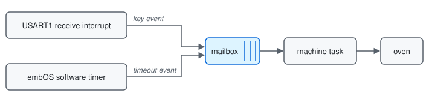

# Microwave oven on embOS-Ultra in QEMU, timeouts as events

A state machine generated by SinelaboreRT runs on SEGGER embOS-Ultra, on an
STM32F405 (Cortex-M4) emulated by QEMU. No board is needed.



What it shows:

- **Timeouts as events.** Each timer of the model runs on an embOS software timer
  (`lib/timer_service/embos_ultra_events`). Its callback posts the timer's event into the
  machine task's mailbox with `OS_MAILBOX_Put()`, which never waits. An every timer posts one
  event per period.
- **One queue for everything.** Keys arrive in the UART receive interrupt and go into the same
  mailbox. The machine task blocks in `OS_MAILBOX_GetBlocked()` and handles one event at a time,
  in arrival order. There is no polling.
- **Observation with embOSView** while it runs: tasks, stack use, CPU load and the API trace.

The model and the generated C code are the same as in `../freertos_posix_timer_events_c`, with
*Timeouts as events* switched on. Only the platform differs.

## What you need

- **Docker.** The image contains the Arm GNU Toolchain 11.2-2022.02, the version the embOS-Ultra
  libraries were built with, and QEMU.
- **embOS-Ultra for Cortex-M and GCC** (`embOS_Ultra_CortexM_GCC_Obj_SFL_V5`). Download it from
  SEGGER and unpack it. It is not part of this example. The build uses its `Start/Inc/RTOS.h`
  and `Start/Lib/libosT7VLDT.a` where they are.
- **Python 3**, for `make test` and `make view`.
- *Optional:* **embOSView** from SEGGER (Windows, Linux or macOS).
- *Optional:* **Java and SinelaboreRT** with *Timeouts as events* (`CODEGEN_PATH` = the folder
  of `codegen.jar`). You only need them after changing `oven.xml`; the generated code is
  included.

## Build and run

```sh
make image                                  # the Docker image, once
export EMBOS=~/embOS_Ultra_CortexM_GCC_Obj_SFL_V5
make                                        # builds build/oven.elf
make run                                    # this terminal is the board's console
```

Keys on the console:

| Key | Event |
| --- | --- |
| `+` / `-` | more / less cooking time |
| `o` / `c` | open / close the door |
| `p` / `P` | power 400 W / 1200 W |

Set a time with `+`, then close the door with `c`: the oven runs and prints a dot every second.
Open the door with `o` and it pauses; close it again and it goes on. Ctrl-C ends QEMU.

## Test

```sh
make test       # sends a key script and compares the output with test/expected.txt
```

QEMU's time follows the executed instructions, so the run gives the same output on every host.

## embOSView

```sh
make view
```

In embOSView, choose *Ethernet* with `127.0.0.1:50021`, then *File > Start*. It shows the task
*Machine* ("Waiting for message in Mailbox"), its stack use, the CPU load and the system
information.

The board answers embOSView on its USART3, which QEMU exposes as a TCP port. embOSView only
reaches a target by UART, J-Link or Ethernet (UDP), so `tools/udp_uart_bridge.py` passes its UDP
packets to the TCP port and back. `make view` starts the bridge and QEMU together.

The build uses the library with API trace (`OS_LIBMODE_DT`), which records embOS calls in a
buffer of 100 entries. embOSView's own requests are recorded too ("ISR level 1") and fill the
buffer within seconds. Choose *Trace > Clear trace* and *Trace > Start trace* just before you
press keys.

## The board

`board/` is the board support for QEMU's netduinoplus2 (STM32F405): startup and vector table,
linker script, the functions `RTOS.h` declares for the board (`OS_InitHW`, `OS_Idle`,
`BSP_OS_GetCycles`, `BSP_OS_StartTimer`), the two UARTs and the C library hooks. Where QEMU
differs from a real STM32F4:

- **Counter and timer.** embOS-Ultra needs a free-running counter and a one-shot timer. QEMU has
  no DWT cycle counter, so the counter is TIM2, which QEMU clocks at 1 GHz, prescaled to
  100 MHz. The one-shot timer is SysTick at 168 MHz, stopped in its handler. Clearing its reload
  value instead, as is usual on hardware, can make QEMU's SysTick fire again and again.
- **Clocks and pins.** QEMU runs the core at 168 MHz whatever the clock registers say, and
  ignores baud rates and pins, so none of them is set up.
- **Time.** `-icount shift=auto,sleep=on` ties the emulated time to the executed instructions
  and lets the idle loop's `WFI` wait in real time, so a second of cooking takes about a second.

## Files

| Path | Contents |
| --- | --- |
| `oven.xml`, `codegen.cfg` | the model and its settings (`TimeoutsAsEvents=yes`) |
| `oven*.c`, `oven*.h` | the generated machine |
| `main.c` | the machine task, the key interrupt handler and the timeout callback |
| `board/` | the board support for QEMU's STM32F405 (see above) |
| `firmware.mk` | the firmware build, run inside the container |
| `test/` | the key script (`run_test.py`) and the expected output |
| `tools/udp_uart_bridge.py` | the bridge between embOSView and the board's USART3 |
